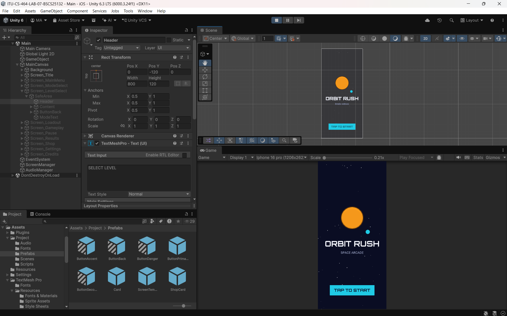
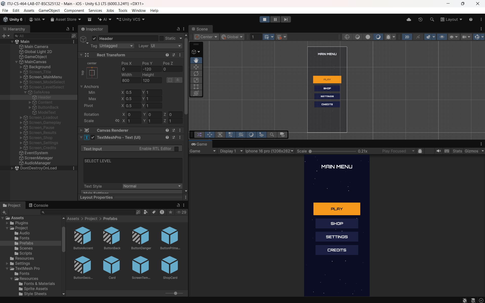
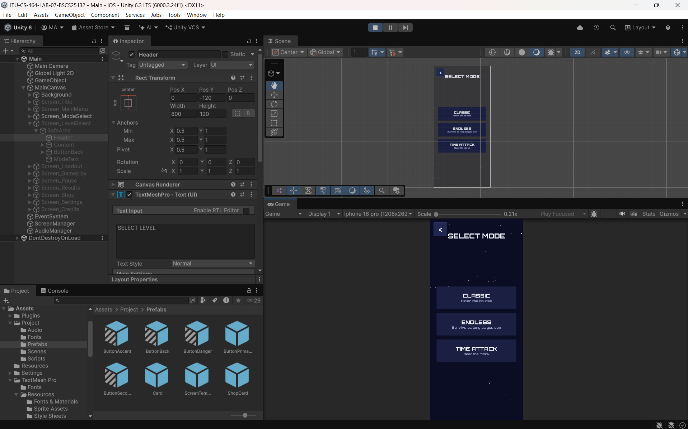
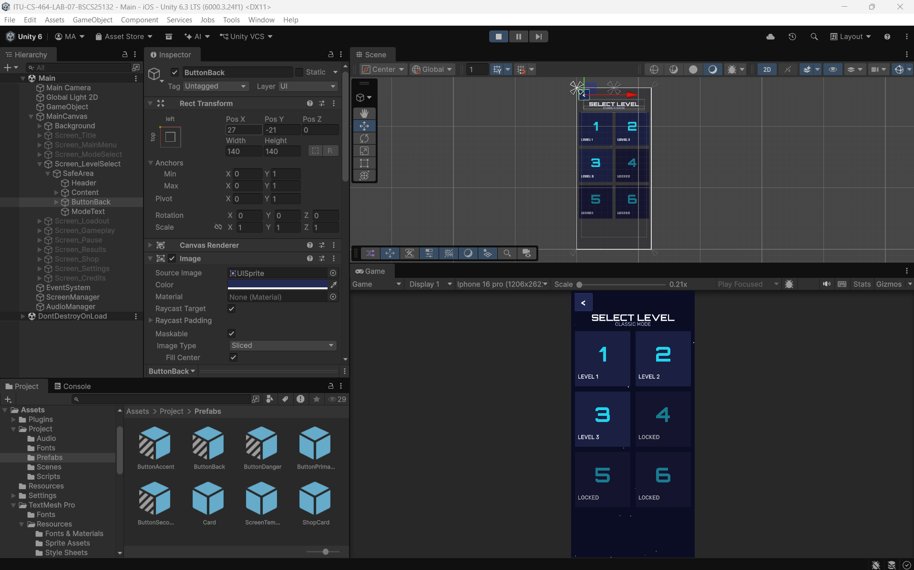
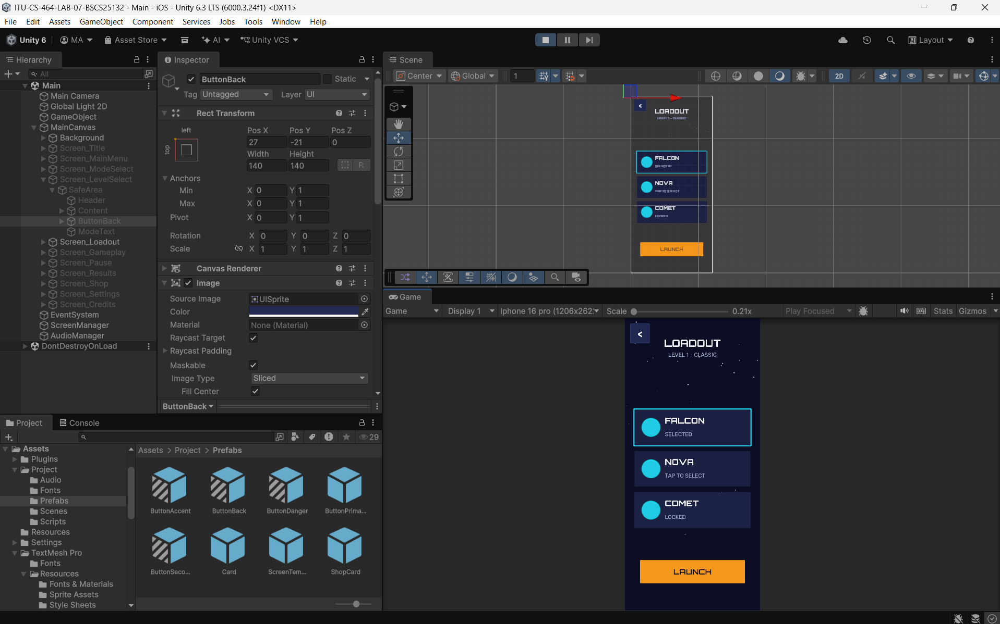
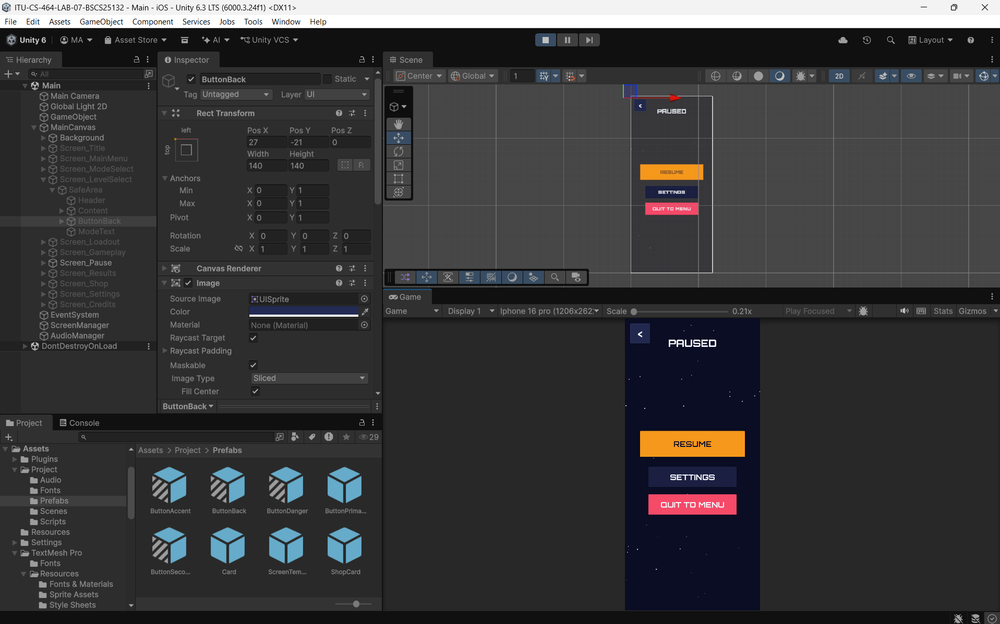
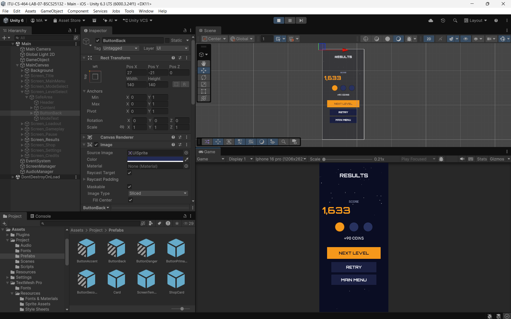
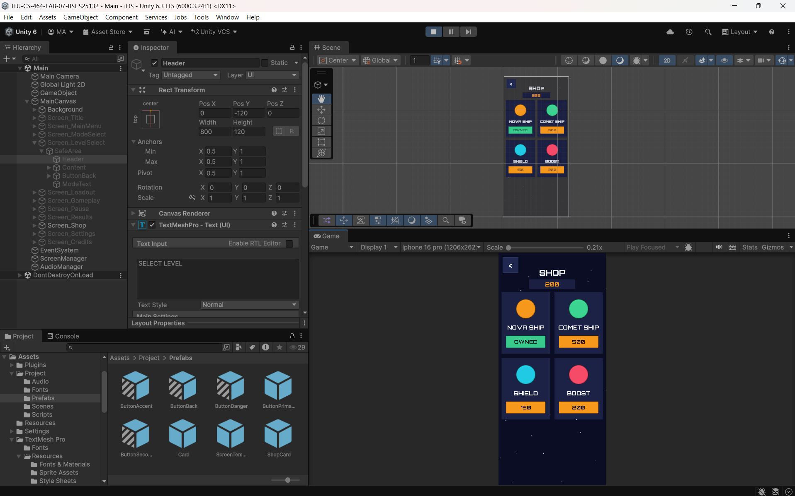
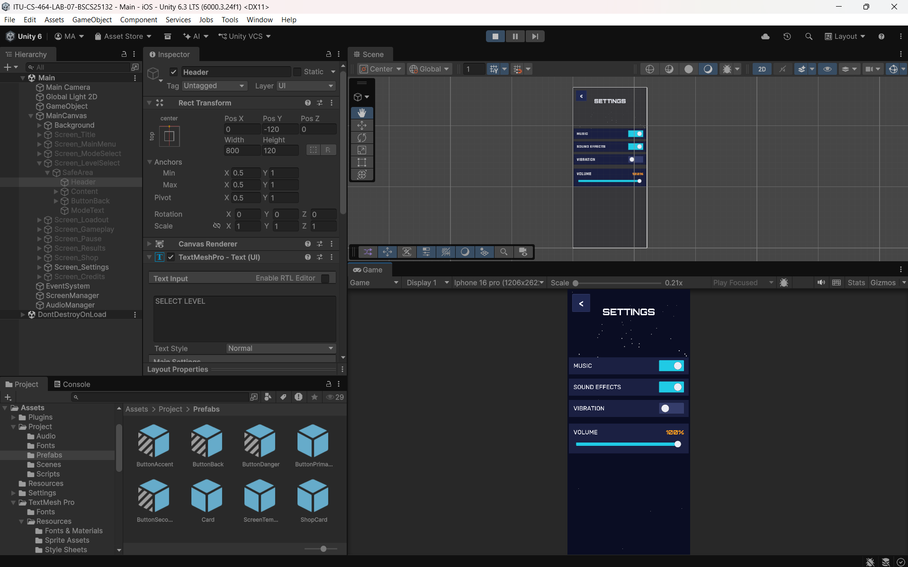
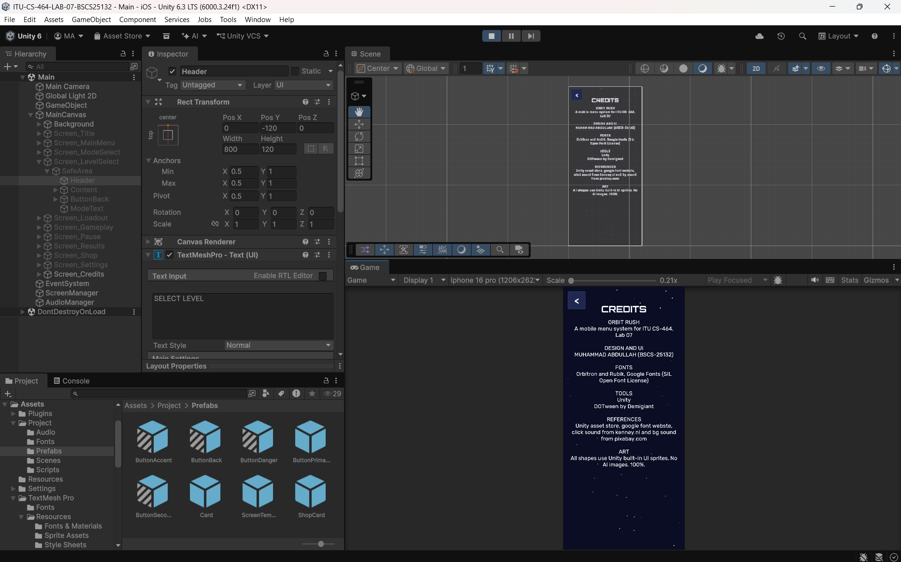

# Orbit Rush - Game Menu (Lab 07)

ITU CS-464 Game Development

**Name:** MUHAMMAD ABDULLAH

**Roll number:** BSCS-25132 (B)

Orbit Rush is a space game. This project is the menu of the game. It has 10 screens made in Unity. All screens are connected, and you can go forward and back on every screen. I used DOTween for the animations.

The Gameplay screen is only a small placeholder. It is there so I can open the Pause and Results screens.

## Demo video

Drive Link : https://drive.google.com/file/d/1st05t1hQRrc-GFXhZeCv26Ee0R0JA7lD/view?usp=sharing 

## How to run

1. Install Unity 6.3 LTS.
2. Clone this repository and open it in Unity Hub.
3. Open the scene `Assets/_Project/Scenes/Main.unity`.
4. Set the Game view to portrait (1080 x 1920).
5. Press Play.

## Screen flow

| Screen | Next | Back |
|---|---|---|
| 1. Title | Main Menu | - |
| 2. Main Menu | Mode Select, Shop, Settings, Credits | - |
| 3. Mode Select | Level Select | Main Menu |
| 4. Level Select | Loadout | Mode Select |
| 5. Loadout | Gameplay | Level Select |
| 6. Pause | Gameplay, Settings, Main Menu | Gameplay |
| 7. Results | Level Select, Gameplay, Main Menu | - |
| 8. Shop | - | Main Menu |
| 9. Settings | - | Previous screen |
| 10. Credits | - | Main Menu |

## Colours and fonts

| Use | Colour |
|---|---|
| Background | #0B1026 (dark blue) |
| Cards and buttons | #1A2145 |
| Highlight | #22D3EE (cyan) |
| Main action and rewards | #FF9F1C (amber) |
| Text | #F4F6FF (light) |
| Small text | #9AA3C7 (grey) |
| Danger | #FF4D6D (red) |
| Success | #3DDC97 (green) |

- Dark background with a few bright colours, so the important things stand out.
- Amber is used only for the most important button on a screen.
- Fonts: Orbitron for titles, Rubik for normal text.
- Buttons are big, so they are easy to tap.
- Items are anchored to the screen edges, so they fit different phone sizes. A safe area script keeps them away from the notch.

## Animations used

| Ease | What it feels like | Where I used it |
|---|---|---|
| OutCubic | Starts fast, ends slow | New screen coming in, fades |
| InCubic | Starts slow, ends fast | Old screen leaving |
| OutBack | Goes a little too far, then settles | Items popping in, switch knob |
| OutQuad | Quick and smooth | Button press |
| InOutSine | Smooth at both ends | Pulsing button text |
| Linear | Same speed all the time | Spinning dot |

On every screen:
- The new screen slides in from the right when going forward, and from the left when going back. This shows the direction.
- Buttons get smaller when pressed and come back with a small bounce. A click sound plays. This shows the tap worked.
- Items appear one after another. The most important item comes first.

## Screens

### 1. Title

- **Purpose:** First screen. Tap to start.
- **Principles:** Big title and one bright button (visual hierarchy). Warm planet and cool dot (colour contrast). Everything is centred.
- **Animations:** Dot spins with Linear, because an orbit has a steady speed. Items rise in with OutBack. Button text pulses with InOutSine to make the player tap.

### 2. Main Menu

- **Purpose:** Home screen. Goes to all parts of the game.
- **Principles:** Play is bigger and amber (hierarchy). The other 3 buttons are the same size with equal gaps (grouping, consistency).
- **Animations:** Buttons rise in one by one with OutBack. Play comes first.

### 3. Mode Select

- **Purpose:** Choose Classic, Endless or Time Attack.
- **Principles:** 3 cards of the same size (consistency). Name is bright and description is small and grey. Back button is always at the top-left.
- **Animations:** Cards rise in one by one with OutBack. Button press uses OutQuad.

### 4. Level Select

- **Purpose:** Choose a level.
- **Principles:** A small line shows the chosen mode. Two-column grid with equal gaps (alignment, spacing). Locked levels are dim, so the player can see them at once.
- **Animations:** Cards pop in with OutBack. A locked card shakes when tapped, to say "not available".

### 5. Loadout

- **Purpose:** Choose a ship.
- **Principles:** 3 equal ship cards. The chosen ship has a cyan outline. Locked ships are dim. Launch is the biggest button (hierarchy).
- **Animations:** The outline fades in with OutCubic. The chosen card grows a little with OutBack, to show it is selected.

### 6. Pause

- **Purpose:** Stop the game, open settings or quit.
- **Principles:** Resume is amber and biggest. Quit is red and far from Resume, so it is not pressed by mistake. Back does the same as Resume.
- **Animations:** Buttons rise in with OutBack. Screen change uses OutCubic and InCubic.

### 7. Results

- **Purpose:** Show the score and what to do next.
- **Principles:** Reads from top to bottom: score, stars, coins, buttons. Amber shows rewards. Next Level is the biggest button.
- **Animations:** The score counts up with OutCubic. The 3 orbits pop in with OutBack, one by one. Buttons come last, so the player sees the result first.

### 8. Shop

- **Purpose:** Spend coins on ships and power-ups.
- **Principles:** Coins are always visible at the top. Equal cards in a grid. Colours show the state: amber price, green OWNED, red when it fails.
- **Animations:** When you buy, the coins count down with OutCubic. When you do not have enough coins, the button shakes and flashes red.

### 9. Settings

- **Purpose:** Music, sound, vibration and volume.
- **Principles:** All rows are the same size. Label on the left, control on the right (alignment). Switches look like real switches: cyan is ON, grey is OFF. The slider shows a number while moving.
- **Animations:** The knob slides with OutBack. The colour changes with OutCubic.

### 10. Credits

- **Purpose:** Shows what tools, fonts and audio I used.
- **Principles:** Short, centred text that is easy to read. Same header and back button as the other screens.
- **Animations:** Text rises in with OutBack.

## Credits

- Tools: Unity, TextMeshPro, DOTween by Demigiant
- Fonts: Orbitron and Rubik (Google Fonts)
- Click sound: click1.ogg, UI Audio pack by Kenney, kenney.nl
- Music: Space Ambient by solarFLEX, from pixabay.com

No AI or GPT images were used. All shapes are Unity's built-in UI sprites.

## Limits

- Right now Gameplay is only a placeholder.
- Coins, bought ships and settings are not saved after you stop Play.